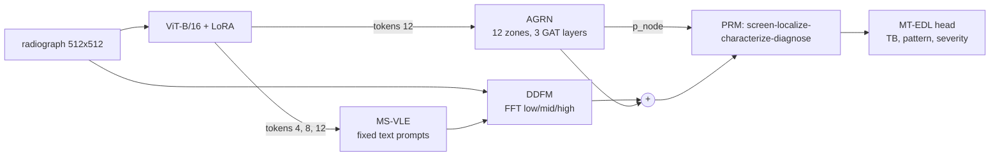

# MARS-TB

Manuscript-derived reference implementation of **"Multi-Scale Vision-Language and Anatomical Graph Reasoning
for Tuberculosis Detection from Chest Radiographs"** (MARS-TB): model, data tooling, training, evaluation,
statistics, explainability, tests and reporting checklists.

> **Read this first.**
> * This is a *re-implementation from the manuscript*. It is **not** the authors' original code and it is not
>   known to be equivalent to it.
> * **No trained weights, no exact historical split files and no model-generated predictions are included** — they
>   have not been supplied. The repository does **not** reproduce any number in the manuscript.
> * The manuscript describes BioViL-T as a ViT-B/16; Microsoft's published BioViL-T image encoder is a ResNet-50
>   hybrid. This repository implements the described ViT-B/16 and does **not** use BioViL-T weights.
> * Research software only. Not a medical device; not validated for clinical use.

## What is implemented and tested

| Area | Status |
|---|---|
| ViT-B/16 backbone with layer 4/8/12 taps, LoRA (r16, a32), timm weight loader | Implemented, unit-tested (numerical parity with timm; 589,824 LoRA params at full size) |
| MS-VLE, DDFM, AGRN, PRM, multi-task evidential head and loss | Implemented, unit-tested |
| Ablations, torchvision baselines (CheXNet/TBNet refused) | Implemented, smoke-tested |
| Preprocessing, augmentation, manifests (JSON-schema), split generator/verifier, leakage audit | Implemented, unit-tested |
| Training loop (AMP, accumulation, early stopping, validation-only selection), checksummed checkpoints | Implemented; **CPU end-to-end tested on synthetic data**; CUDA/AMP and multi-GPU paths **not exercised** |
| Metrics, DeLong, bootstrap (patient-clustered), Holm, calibration, uncertainty, thresholds | Implemented, tested against scikit-learn / scipy / closed forms |
| Grad-CAM++, zone occlusion, graph attention, localisation metrics | Implemented, unit-tested |
| Manuscript consistency audit, parameter accounting, CLAIM 2024 and TRIPOD+AI checklists | Generated (`reporting/`) |

Quality assurance (this environment, CPU): **265 tests pass** (+1 full-size test run separately with
`-m slow`), **97 % line coverage** of `src/mars_tb`, `ruff` clean, `mypy` clean (48 source files).

| Needs | Cannot be done yet because |
|---|---|
| The TBX11K / PadChest / TB Portals images | not redistributable; not present here |
| A trained checkpoint | none exists in verified form |
| Reproducing the published AUCs | needs the authors' artifacts (`reporting/reproducibility_status.md`) |

## Architecture


Details, tensor shapes and every deviation from the manuscript: [docs/architecture.md](docs/architecture.md),
[docs/manuscript_to_code_mapping.md](docs/manuscript_to_code_mapping.md),
[docs/known_discrepancies.md](docs/known_discrepancies.md).

## Install

```bash
pip install -e ".[dev]"      # see docs/installation.md (GPU users: install CUDA PyTorch first)
python -m pytest -m "not slow"
```

## Use

```bash
# data (you supply the images; nothing is downloaded)
python scripts/prepare_tbx11k.py --root <TBX11K> --out data/manifests/tbx11k.csv
python scripts/generate_splits.py --manifest data/manifests/tbx11k.csv --root <TBX11K> --name s0 --seed 0 --strata label
python scripts/verify_splits.py --split-csv data/splits/s0.csv --root <TBX11K>
python scripts/audit_data_leakage.py --split-csv data/splits/s0.csv --root <TBX11K>

# train / evaluate / explain
python scripts/train.py --split-csv data/splits/s0.csv --root <TBX11K> --out-dir runs/seed42 --seed 42
python scripts/evaluate.py --checkpoint runs/seed42/best.ckpt --manifest data/splits/s0.csv --root <TBX11K> \
       --dataset tbx11k --split test --only-split test --out-predictions pred.csv --out-metrics metrics.json
python scripts/generate_explanations.py --checkpoint runs/seed42/best.ckpt --manifest data/splits/s0.csv \
       --root <TBX11K> --predictions pred.csv --category FP --out-dir results/figures/fp

# no data? run everything on synthetic images
python scripts/make_synthetic_fixture.py --out-dir /tmp/syn
```

Guides: [training](docs/training.md) · [inference](docs/inference.md) · [evaluation](docs/evaluation.md) ·
[statistics](docs/statistics.md) · [explainability](docs/explainability.md) ·
[preprocessing](docs/preprocessing.md) · [data provenance](docs/data_provenance.md) ·
[reproduction](docs/reproduction.md).

## Expected file formats
Manifest, split-sidecar and prediction schemas are in `data/schemas/`, examples in `data/templates/`.
Predictions: `dataset, split, image_id, patient_id, model, seed, actual_label, p_tb, predicted_label, threshold,
uncertainty, alpha_negative, alpha_positive, checkpoint_hash`.

## Checkpoint availability
None. See [checkpoints/README.md](checkpoints/README.md) and [reporting/artifact_inventory.csv](reporting/artifact_inventory.csv).

## Reproducibility and reporting
* [reporting/reproducibility_status.md](reporting/reproducibility_status.md) — what is and is not reproducible
* [reporting/manuscript_consistency_audit.md](reporting/manuscript_consistency_audit.md) — arithmetic audit of the manuscript's reported numbers
* [reporting/CLAIM_2024_checklist.csv](reporting/CLAIM_2024_checklist.csv), [reporting/TRIPOD_AI_2024_checklist.csv](reporting/TRIPOD_AI_2024_checklist.csv)
* [reporting/editor_comment_10_response.md](reporting/editor_comment_10_response.md)
* [docs/model_card.md](docs/model_card.md), [docs/dataset_card.md](docs/dataset_card.md), [docs/limitations.md](docs/limitations.md)

## Citation
See [CITATION.cff](CITATION.cff). The manuscript is under review; no DOI exists yet.

## Licence and third-party notices
No licence has been chosen yet — see [docs/licensing_status.md](docs/licensing_status.md) (dependency
licences are listed there). Dataset licences are separate and are not covered by any code licence.

## Clinical-use disclaimer
This software and any model trained with it are for research only. They must not be used to diagnose, screen,
triage or make treatment decisions for patients.
